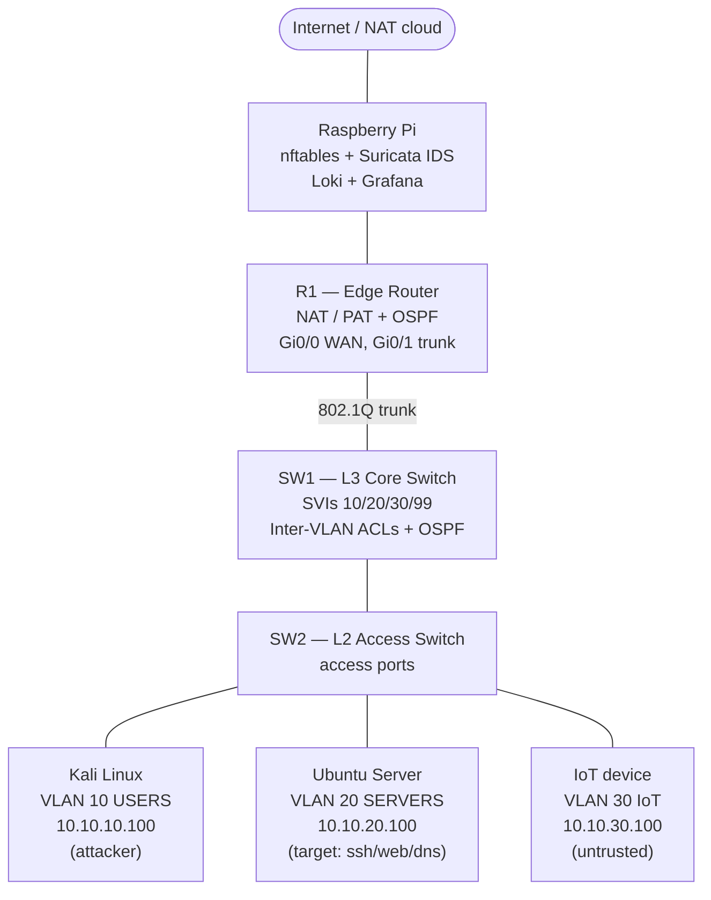

# Network Topology

Build this exact topology in GNS3/EVE-NG. Device names match the config files in
[`../cisco/`](../cisco/).

## Interface map

| Device | Interface | Connects to | Role |
|--------|-----------|-------------|------|
| R1 | Gi0/0 | Internet cloud / Pi | WAN (NAT outside) |
| R1 | Gi0/1 | SW1 Gi0/1 | 802.1Q trunk (NAT inside) |
| SW1 | Gi0/1 | R1 Gi0/1 | trunk / OSPF |
| SW1 | Gi0/2 | SW2 Gi0/1 | trunk |
| SW1 | (SVIs) | — | VLAN 10/20/30/99 gateways |
| SW2 | Gi0/1 | SW1 Gi0/2 | trunk |
| SW2 | Gi0/2 | Kali | access VLAN 10 |
| SW2 | Gi0/3 | Ubuntu server | access VLAN 20 |
| SW2 | Gi0/4 | IoT device | access VLAN 30 |

## GNS3 image notes

- **SW1 / SW2:** use **IOSvL2** (vIOS-L2) for VLANs + L3 switching. If you only
  have IOU/IOL L2 images, that works too.
- **R1:** **IOSv** or a c7200 router image for NAT + OSPF.
- **Kali:** import the official Kali VMware/VirtualBox appliance, attach its NIC
  to the GNS3 cloud/the Kali node.
- If your laptop is low on RAM, you can collapse SW1+SW2 into a single L3 switch
  (router-on-a-stick alternative noted inside `cisco/SW1-core-L3.cfg`).
